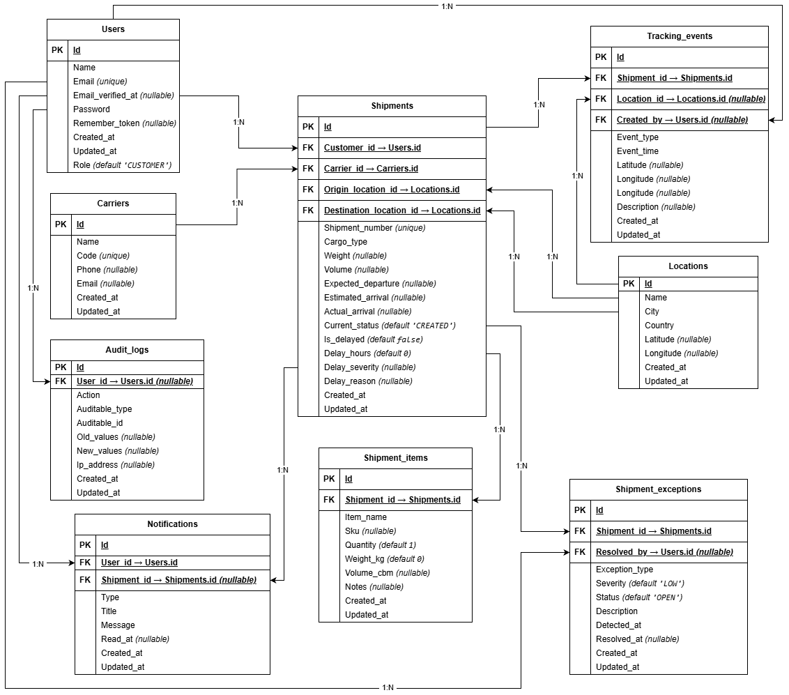

# CargoTrace_Laravel

Logistics management and shipment tracking platform built with **Laravel**, **Laravel Sanctum** token-based authentication, and **TiDB Cloud** as the database backend. It includes both web operational dashboards (including automated in-app notifications) and a RESTful API, along with **Postman** collections and environments (`CargoTrace API Tests` and `CargoTrace Local`) for endpoint verification and CRUD lifecycle testing.

## Overview
`CargoTrace_Laravel` provides web workflows and authenticated RESTful endpoints to manage shipments, record tracking checkpoints, handle operational exceptions, and trigger automated in-app notifications across shipment, tracking, and exception events.

## Entity Relationship Diagram (ERD)

The **CargoTrace** database uses **9 relational tables** with **`1:N`** (*one-to-many*) cardinalities centered around the `Shipments` entity.



### Relationships & Cardinalities (`1:N`)

* **`Users` (1) ─── (N) `Shipments`** via `Shipments.Customer_id`
* **`Users` (1) ─── (N) `Tracking_events`** via `Tracking_events.Created_by`
* **`Users` (1) ─── (N) `Shipment_exceptions`** via `Shipment_exceptions.Resolved_by`
* **`Users` (1) ─── (N) `Notifications`** via `Notifications.User_id`
* **`Users` (1) ─── (N) `Audit_logs`** via `Audit_logs.User_id`
* **`Carriers` (1) ─── (N) `Shipments`** via `Shipments.Carrier_id`
* **`Locations` (1) ─── (N) `Shipments`** via `Shipments.Origin_location_id`
* **`Locations` (1) ─── (N) `Shipments`** via `Shipments.Destination_location_id`
* **`Locations` (1) ─── (N) `Tracking_events`** via `Tracking_events.Location_id`
* **`Shipments` (1) ─── (N) `Shipment_items`** via `Shipment_items.Shipment_id`
* **`Shipments` (1) ─── (N) `Tracking_events`** via `Tracking_events.Shipment_id`
* **`Shipments` (1) ─── (N) `Shipment_exceptions`** via `Shipment_exceptions.Shipment_id`
* **`Shipments` (1) ─── (N) `Notifications`** via `Notifications.Shipment_id`

*(Note: `Audit_logs` also supports polymorphic references via `Auditable_type` and `Auditable_id` in addition to its `User_id` relationship.)*

## Data Dictionary

### 1. `Users`
Stores system user accounts (such as customers, operators, or administrators).

| Column | Data Type | Constraint / Default | Description |
| :--- | :--- | :--- | :--- |
| `Id` | `BIGINT UNSIGNED` | `PK`, `AUTO_INCREMENT`, `NOT NULL` | Unique user identifier |
| `Name` | `VARCHAR(255)` | `NOT NULL` | Full name of the user |
| `Email` | `VARCHAR(255)` | `UNIQUE`, `NOT NULL` | Unique email address for authentication and notifications |
| `Email_verified_at` | `TIMESTAMP` | `NULLABLE` | Timestamp when the email address was verified |
| `Password` | `VARCHAR(255)` | `NOT NULL` | Hashed user password |
| `Remember_token` | `VARCHAR(100)` | `NULLABLE` | Session remember token |
| `Role` | `VARCHAR(50)` | `DEFAULT 'CUSTOMER'`, `NOT NULL` | Role assigned to the user in the system |
| `Created_at` | `TIMESTAMP` | `NULLABLE` | Record creation timestamp |
| `Updated_at` | `TIMESTAMP` | `NULLABLE` | Record last update timestamp |

### 2. `Carriers`
Stores logistics and freight carrier company records.

| Column | Data Type | Constraint / Default | Description |
| :--- | :--- | :--- | :--- |
| `Id` | `BIGINT UNSIGNED` | `PK`, `AUTO_INCREMENT`, `NOT NULL` | Unique carrier identifier |
| `Name` | `VARCHAR(255)` | `NOT NULL` | Carrier company name |
| `Code` | `VARCHAR(50)` | `UNIQUE`, `NOT NULL` | Unique carrier code |
| `Phone` | `VARCHAR(50)` | `NULLABLE` | Carrier contact phone number |
| `Email` | `VARCHAR(255)` | `NULLABLE` | Carrier contact email address |
| `Created_at` | `TIMESTAMP` | `NULLABLE` | Record creation timestamp |
| `Updated_at` | `TIMESTAMP` | `NULLABLE` | Record last update timestamp |

### 3. `Locations`
Stores origin, destination, hub, warehouse, or checkpoint locations.

| Column | Data Type | Constraint / Default | Description |
| :--- | :--- | :--- | :--- |
| `Id` | `BIGINT UNSIGNED` | `PK`, `AUTO_INCREMENT`, `NOT NULL` | Unique location identifier |
| `Name` | `VARCHAR(255)` | `NOT NULL` | Facility or location name |
| `City` | `VARCHAR(100)` | `NOT NULL` | City name |
| `Country` | `VARCHAR(100)` | `NOT NULL` | Country name |
| `Latitude` | `DECIMAL(10,7)` | `NULLABLE` | Geographic latitude coordinate |
| `Longitude` | `DECIMAL(10,7)` | `NULLABLE` | Geographic longitude coordinate |
| `Created_at` | `TIMESTAMP` | `NULLABLE` | Record creation timestamp |
| `Updated_at` | `TIMESTAMP` | `NULLABLE` | Record last update timestamp |

### 4. `Shipments`
Core shipment transaction table linking customers, carriers, and origin/destination locations.

| Column | Data Type | Constraint / Default | Description |
| :--- | :--- | :--- | :--- |
| `Id` | `BIGINT UNSIGNED` | `PK`, `AUTO_INCREMENT`, `NOT NULL` | Unique shipment identifier |
| `Customer_id` | `BIGINT UNSIGNED` | `FK -> Users.Id`, `NOT NULL` | Customer owning the shipment |
| `Carrier_id` | `BIGINT UNSIGNED` | `FK -> Carriers.Id`, `NOT NULL` | Carrier handling the shipment |
| `Origin_location_id` | `BIGINT UNSIGNED` | `FK -> Locations.Id`, `NOT NULL` | Origin location of the shipment |
| `Destination_location_id` | `BIGINT UNSIGNED` | `FK -> Locations.Id`, `NOT NULL` | Destination location of the shipment |
| `Shipment_number` | `VARCHAR(100)` | `UNIQUE`, `NOT NULL` | Unique shipment tracking/reference number |
| `Cargo_type` | `VARCHAR(100)` | `NOT NULL` | Type or category of cargo |
| `Weight` | `DECIMAL(10,2)` | `NULLABLE` | Total cargo weight |
| `Volume` | `DECIMAL(10,3)` | `NULLABLE` | Total cargo volume |
| `Expected_departure` | `DATETIME` | `NULLABLE` | Scheduled departure time |
| `Expected_arrival` | `DATETIME` | `NULLABLE` | Scheduled arrival time |
| `Estimated_arrival` | `DATETIME` | `NULLABLE` | Current estimated time of arrival (ETA) |
| `Actual_arrival` | `DATETIME` | `NULLABLE` | Actual arrival time at destination |
| `Current_status` | `VARCHAR(50)` | `DEFAULT 'CREATED'`, `NOT NULL` | Current shipment status |
| `Is_delayed` | `BOOLEAN` | `DEFAULT FALSE`, `NOT NULL` | Indicates whether the shipment is delayed |
| `Delay_hours` | `INT` | `DEFAULT 0`, `NOT NULL` | Delay duration in hours |
| `Delay_severity` | `VARCHAR(50)` | `NULLABLE` | Severity level of the delay |
| `Delay_reason` | `TEXT` | `NULLABLE` | Reason or notes for the delay |
| `Created_at` | `TIMESTAMP` | `NULLABLE` | Record creation timestamp |
| `Updated_at` | `TIMESTAMP` | `NULLABLE` | Record last update timestamp |

### 5. `Shipment_items`
Stores line-item details included within a shipment.

| Column | Data Type | Constraint / Default | Description |
| :--- | :--- | :--- | :--- |
| `Id` | `BIGINT UNSIGNED` | `PK`, `AUTO_INCREMENT`, `NOT NULL` | Unique shipment item identifier |
| `Shipment_id` | `BIGINT UNSIGNED` | `FK -> Shipments.Id`, `NOT NULL` | Referenced parent shipment |
| `Item_name` | `VARCHAR(255)` | `NOT NULL` | Item or product name |
| `Sku` | `VARCHAR(100)` | `NULLABLE` | Stock Keeping Unit (SKU) code |
| `Quantity` | `INT` | `DEFAULT 1`, `NOT NULL` | Number of item units |
| `Weight_kg` | `DECIMAL(10,2)` | `DEFAULT 0`, `NOT NULL` | Item weight in kilograms (kg) |
| `Volume_cbm` | `DECIMAL(10,3)` | `NULLABLE` | Item volume in cubic meters (CBM) |
| `Notes` | `TEXT` | `NULLABLE` | Additional notes for the item |
| `Created_at` | `TIMESTAMP` | `NULLABLE` | Record creation timestamp |
| `Updated_at` | `TIMESTAMP` | `NULLABLE` | Record last update timestamp |

### 6. `Tracking_events`
Records movement checkpoints and status events throughout a shipment's lifecycle.

| Column | Data Type | Constraint / Default | Description |
| :--- | :--- | :--- | :--- |
| `Id` | `BIGINT UNSIGNED` | `PK`, `AUTO_INCREMENT`, `NOT NULL` | Unique tracking event identifier |
| `Shipment_id` | `BIGINT UNSIGNED` | `FK -> Shipments.Id`, `NOT NULL` | Referenced shipment |
| `Event_type` | `VARCHAR(100)` | `NOT NULL` | Type of tracking event |
| `Event_time` | `DATETIME` | `NOT NULL` | Timestamp when the event occurred |
| `Location_id` | `BIGINT UNSIGNED` | `FK -> Locations.Id`, `NULLABLE` | Location where the event occurred |
| `Latitude` | `DECIMAL(10,7)` | `NULLABLE` | Latitude coordinate at the event |
| `Longitude` | `DECIMAL(10,7)` | `NULLABLE` | Longitude coordinate at the event |
| `Description` | `TEXT` | `NULLABLE` | Detailed description of the event |
| `Created_by` | `BIGINT UNSIGNED` | `FK -> Users.Id`, `NULLABLE` | User who recorded the event |
| `Created_at` | `TIMESTAMP` | `NULLABLE` | Record creation timestamp |
| `Updated_at` | `TIMESTAMP` | `NULLABLE` | Record last update timestamp |

### 7. `Shipment_exceptions`
Tracks operational issues or exceptions encountered during a shipment and their resolution status.

| Column | Data Type | Constraint / Default | Description |
| :--- | :--- | :--- | :--- |
| `Id` | `BIGINT UNSIGNED` | `PK`, `AUTO_INCREMENT`, `NOT NULL` | Unique exception identifier |
| `Shipment_id` | `BIGINT UNSIGNED` | `FK -> Shipments.Id`, `NOT NULL` | Referenced shipment experiencing the issue |
| `Exception_type` | `VARCHAR(100)` | `NOT NULL` | Category or type of exception |
| `Severity` | `VARCHAR(50)` | `DEFAULT 'LOW'`, `NOT NULL` | Exception severity level |
| `Status` | `VARCHAR(50)` | `DEFAULT 'OPEN'`, `NOT NULL` | Current exception resolution status |
| `Description` | `TEXT` | `NOT NULL` | Detailed description of the exception |
| `Detected_at` | `DATETIME` | `NOT NULL` | Timestamp when the exception was detected |
| `Resolved_at` | `DATETIME` | `NULLABLE` | Timestamp when the exception was resolved |
| `Resolved_by` | `BIGINT UNSIGNED` | `FK -> Users.Id`, `NULLABLE` | User who resolved the exception |
| `Created_at` | `TIMESTAMP` | `NULLABLE` | Record creation timestamp |
| `Updated_at` | `TIMESTAMP` | `NULLABLE` | Record last update timestamp |

### 8. `Notifications`
Stores in-app notifications delivered to users for shipment, tracking, and exception activity.

| Column | Data Type | Constraint / Default | Description |
| :--- | :--- | :--- | :--- |
| `Id` | `BIGINT UNSIGNED` | `PK`, `AUTO_INCREMENT`, `NOT NULL` | Unique notification identifier |
| `User_id` | `BIGINT UNSIGNED` | `FK -> Users.Id`, `NOT NULL` | Recipient user |
| `Shipment_id` | `BIGINT UNSIGNED` | `FK -> Shipments.Id`, `NULLABLE` | Related shipment (if applicable) |
| `Type` | `VARCHAR(100)` | `NOT NULL` | Notification type or category |
| `Title` | `VARCHAR(255)` | `NOT NULL` | Notification title |
| `Message` | `TEXT` | `NOT NULL` | Notification body message |
| `Read_at` | `TIMESTAMP` | `NULLABLE` | Timestamp when the notification was read |
| `Created_at` | `TIMESTAMP` | `NULLABLE` | Record creation timestamp |
| `Updated_at` | `TIMESTAMP` | `NULLABLE` | Record last update timestamp |

### 9. `Audit_logs`
Records audit trails of data changes (`Old_values` and `New_values`) and user actions across the platform.

| Column | Data Type | Constraint / Default | Description |
| :--- | :--- | :--- | :--- |
| `Id` | `BIGINT UNSIGNED` | `PK`, `AUTO_INCREMENT`, `NOT NULL` | Unique audit log identifier |
| `User_id` | `BIGINT UNSIGNED` | `FK -> Users.Id`, `NULLABLE` | User who performed the action |
| `Action` | `VARCHAR(100)` | `NOT NULL` | Action performed (e.g., `created`, `updated`, `deleted`) |
| `Auditable_type` | `VARCHAR(255)` | `NOT NULL` | Target model class name (polymorphic) |
| `Auditable_id` | `BIGINT UNSIGNED` | `NOT NULL` | Target record ID |
| `Old_values` | `JSON` | `NULLABLE` | Snapshot of values prior to modification |
| `New_values` | `JSON` | `NULLABLE` | Snapshot of values after modification |
| `Ip_address` | `VARCHAR(45)` | `NULLABLE` | Client IP address associated with the request |
| `Created_at` | `TIMESTAMP` | `NULLABLE` | Log creation timestamp |
| `Updated_at` | `TIMESTAMP` | `NULLABLE` | Log last update timestamp |

## Tech Stack & Infrastructure
- **Backend Framework:** Laravel (local development server via `php artisan serve`)
- **Authentication:** Laravel Sanctum (Bearer Token authentication) & session-based web auth
- **Database:** TiDB Cloud
- **API Testing & Workspace:** Postman (`postman/` directory containing collections, environments, and workspace files)
- **Containerization / Deployment Configs:** `Dockerfile`, `fly.toml` (present in repository)

## Key Features
- **Shipment Management:** Create, view, update, and delete shipments with carrier, origin/destination location, customer, and ETA/delay evaluation (`EtaService`).
- **Tracking Events:** Log and inspect shipment movement checkpoints (`CREATED`, `BOOKED`, `PICKED_UP`, `IN_TRANSIT`, `ARRIVED`, `DELIVERED`, `DELAYED`) and view shipment tracking history.
- **Exception Handling:** Record operational issues (`OPEN`) and mark them as resolved (`RESOLVED`).
- **Automated In-App Notifications:** `NotificationService` automatically creates notifications (`AppNotification`) upon tracking updates, shipment creation/status/delay updates, and exception creation/resolution.

## Project Structure (Key Directories)
- `app/` — Controllers (`ShipmentController`, `TrackingController`, `ExceptionController`, etc.), models (`AppNotification`, `Shipment`, `TrackingEvent`, `ShipmentException`, etc.), services (`NotificationService`, `EtaService`), policies, and middleware
- `database/` — Migrations, seeders (`DatabaseSeeder`), factories, and database configuration
- `docs/` — Project documentation assets
- `routes/` — API and web route definitions
- `postman/` — Postman collections (`CargoTrace API Tests`), environments (`CargoTrace Local`), and workspace resources

## Application & API Links
- **Local Web URL:** [http://127.0.0.1:8000](http://127.0.0.1:8000) (open in browser while `php artisan serve` is running)
- **Live Web URL:** [https://cargotrace-laravel.fly.dev](https://cargotrace-laravel.fly.dev)
- **API Base Prefix (for Postman):** `/api` (e.g., `http://127.0.0.1:8000/api/shipments` or `https://cargotrace-laravel.fly.dev/api/shipments`; `/api` alone is not a browser page)

## Prerequisites & Local Setup
1. **Clone & Install Dependencies:** Ensure PHP, Composer, and required Laravel packages are installed in your local environment.
2. **Environment Configuration:** Configure `.env` with valid database credentials pointing to **TiDB Cloud** and generate the application key if needed:
   ```bash
   cp .env.example .env
   php artisan key:generate
   
3. **Run Migrations & Seeder:**
   ```bash
   php artisan migrate --seed
   ```
4. **Run the Development Server:**
   ```bash
   php artisan serve
   ```
5. **Configure Postman:**
   - Open Postman and select the **CargoTrace Local** environment.
   - Set `base_url` to your local server URL (e.g., `http://127.0.0.1:8000`).
   - Authenticate via login to obtain and store your Sanctum Bearer Token (`{{token}}`).

## Authentication & Request Conventions
- Protected API endpoints require an `Authorization: Bearer <token>` header issued through Sanctum.
- API requests expect JSON headers such as `Accept: application/json` (and `Content-Type: application/json` when sending JSON payloads).
- Invalid payloads or disallowed business state transitions return `422 Unprocessable Entity`, while missing records return `404 Not Found`.

## API Endpoints & CRUD Testing Summary

| Method | Endpoint | Purpose | Expected / Verified Behavior |
| :--- | :--- | :--- | :--- |
| `POST` | `/api/login` | User login (`admin@cargotrace.test`) | Issues Sanctum token |
| `GET` | `/api/user` | Authenticated user profile | Returns user data (`200 OK`) |
| `GET` | `/api/shipments` | List shipments | Returns paginated shipment list (`200 OK`) |
| `GET` | `/api/shipments/{id}` | Get shipment details & relations | Returns shipment record (`200 OK`) or `404` if ID not found |
| `POST` | `/api/shipments` | Create shipment | Validates input (`422`), creates (`201 Created`) |
| `PUT` / `PATCH` | `/api/shipments/{id}` | Update shipment / status | Checks status flow (`422`), updates (`200 OK`), or `404` if ID not found |
| `DELETE` | `/api/shipments/{id}` | Delete shipment record | Deletes cleanly (`200 OK`) or `404` if ID not found |